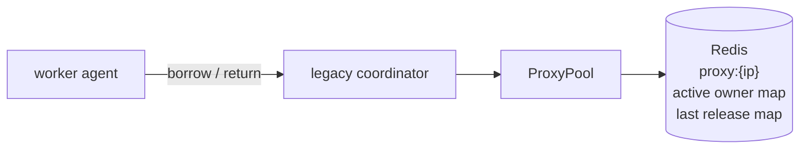
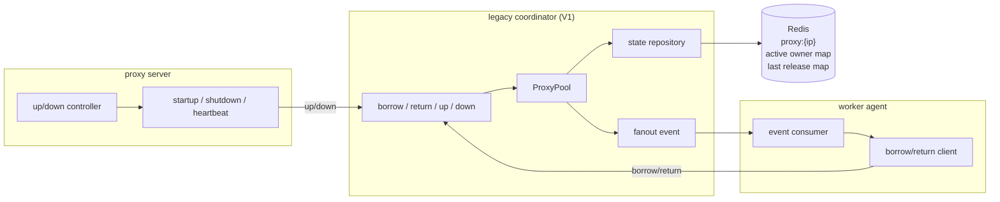
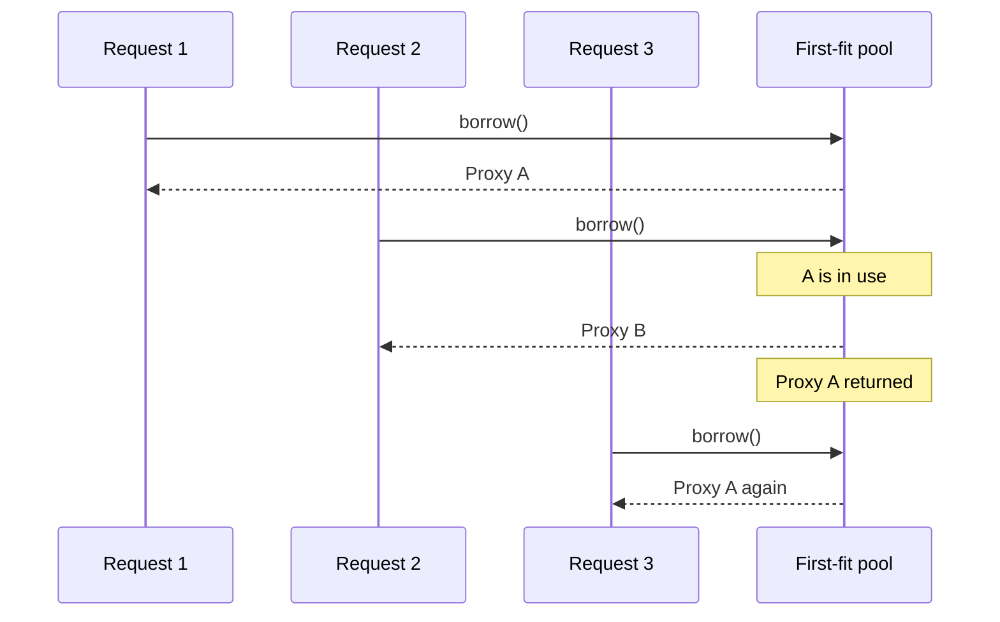

# 왜 프록시 풀을 다시 설계했는가: 순차적 선택과 도메인 비인식 모델의 한계

## 왜 이 글을 쓰는가

프록시 시스템을 V1에서 V2로 바꿨다고 하면, 보통은 `Lua`, `TTL`, `requestId` 같은 구현 디테일부터 먼저 떠올리기 쉽습니다. 하지만 실제 운영에서 먼저 드러난 문제는 그보다 앞단에 있었습니다.

- 일부 프록시만 반복 사용됐다
- 차단된 프록시를 다시 받았다
- 도메인별 상태를 표현하기 어려웠다

가장 중요했던 문제는 편중 자체보다 차단이었습니다.

순차적 선택 구조에서는 앞쪽 프록시에 사용이 몰렸고, 저는 그 편중이 일부 프록시를 더 빨리 소모시키는 방향으로 작동한다고 판단했습니다.

물론 외부 사이트의 차단 기준은 공개되어 있지 않기 때문에, "이 구조 때문에 차단이 빨라졌다"는 인과를 완전하게 증명할 수는 없습니다.
실패 원인에는 대상 사이트 정책, 요청 패턴, 크롤링 로직 자체의 문제도 함께 섞여 있었을 수 있습니다.

그럼에도 운영에서 관찰한 분포와 당시 코드 구조를 함께 보면, 앞쪽 프록시 편중과 도메인 비인식 모델이 차단을 더 자주 반복시키는 방향으로 작동했을 가능성이 높다고 봤습니다.
제가 V2가 필요하다고 느낀 가장 큰 이유도 여기에 있었습니다. 단순히 더 고르게 분산하고 싶어서가 아니라, 차단 상태를 도메인 기준으로 분리해서 다룰 수 있는 구조가 필요하다고 판단했습니다.

즉 출발점은 정합성보다 선택 정책과 상태 모델의 한계였습니다. 이 글은 왜 V2라는 새 모델이 필요해졌는지 설명하는 1편입니다.

핵심은 단순합니다. V1의 문제는 "코드가 조금 지저분했다"가 아니라, 프록시 풀을 바라보는 방식 자체가 운영 요구와 맞지 않았다는 점입니다. 여기서는 V1이 왜 더 이상 버티기 어려웠는지에만 집중합니다.

## 시작점은 사실상 순차적 선택(first-fit)이었습니다

V1의 borrow 로직은 개념적으로 이렇게 요약할 수 있습니다.

```java
for (ProxyState proxy : allProxies()) {
    if (!proxy.isUsedBy(appName) && reuseDelayPassed(proxy, appName)) {
        markBorrowed(proxy, appName);
        save(proxy);
        return proxy;
    }
}
```



요청 흐름만 보면 단순해 보이지만, 실제 구조를 한 단계 더 펼치면 V1은 아래와 같은 형태에 가까웠습니다.



이 구조에서 핵심 상태는 `proxy:{ip}` 단위의 점유 정보와 재사용 대기 시간에 가까웠습니다.
즉 "누가 지금 이 프록시를 쓰고 있는가"는 볼 수 있었지만, "이 프록시가 특정 도메인에서 막혔는가"를 풀 수준에서 분리해 표현하는 구조는 아니었습니다.

핵심은 세 단계입니다.

1. 프록시 목록을 순회한다
2. 조건을 만족하는 첫 번째 프록시를 고른다
3. 즉시 저장하고 반환한다

이건 전형적인 `순차적 선택`입니다.
작은 규모에서는 구현이 단순하고 빠르게 붙일 수 있습니다. 문제는 운영 규모가 커지면 이 구조가 앞쪽 후보에 유리한 편향을 만들기 쉽다는 점입니다.

명세 수준에서 "항상 같은 순서"라고 단정할 수는 없습니다. 다만 실제 운영에서는 앞쪽 프록시가 반복적으로 먼저 선택되는 패턴이 관찰됐고, 결과적으로 일부 프록시만 계속 active이고 나머지는 오래 idle로 남는 불균형이 드러났습니다.

운영 Redis 스냅샷을 보면, 실제로는 소수 프록시만 active owner 정보를 가지고 있고 나머지는 빈 상태로 남아 있는 구간이 반복적으로 보였습니다.
즉 이 문제는 추정이 아니라, `일부만 계속 점유되고 다수는 놀고 있는 분포`라는 형태로 관찰된 운영 신호에 가까웠습니다.

## 순차적 선택이 만든 세 가지 문제

### 1. 앞쪽 후보만 반복해서 쓰게 됐습니다

프록시가 `A`, `B`, `C`, `D` 순으로 보인다고 가정해보겠습니다.

1. 서비스 A가 요청하면 `A`를 받습니다.
2. 서비스 B는 `A`가 사용 중이므로 `B`를 받습니다.
3. 서비스 C는 `C`를 받습니다.
4. 이후 `A`가 반납되면, 다음 요청자는 다시 `A`를 먼저 보게 됩니다.

즉 앞쪽 프록시는 반납되자마자 다음 요청에 다시 잡히고, 뒤쪽 프록시는 앞쪽 후보가 전부 사용 중일 때만 기회를 얻습니다.
이 패턴이 장기 점유와 결합되면, 겉보기에는 프록시 수가 충분한데 실제로는 일부만 반복 사용되는 상태가 만들어집니다.

그 흐름을 단순화하면 아래 그림에 가깝습니다.



이 문제는 단순한 분배 비효율로 끝나지 않습니다.
편중된 프록시는 더 자주 차단되고 더 빨리 소모됩니다. 즉 선택 정책의 편향이 그대로 운영 리스크로 번집니다.

### 2. 도메인을 모르는 풀이라 차단 상태를 다루기 어려웠습니다

V1의 판단 기준은 대체로 이 정도였습니다.

```java
!proxy.isUsedBy(appName) && reuseDelayPassed(proxy, appName)
```

즉 "이 앱이 지금 이 프록시를 쓰고 있는가"와 "반납 후 재사용 대기 시간이 지났는가" 정도만 봅니다.
반대로 "이 프록시가 특정 도메인에서 차단됐는가"는 표현하기 어렵습니다.

이건 단순한 조건 누락이 아니라 모델의 한계입니다.
프록시의 사용 가능성은 현재 점유 여부만으로 결정되지 않습니다. 실제 차단이나 품질 저하는 특정 도메인에서만 발생할 수 있습니다.

예를 들어 어떤 프록시가 `domain-a`에서는 막혔지만 `domain-b`에서는 정상일 수 있습니다.
그런데 도메인을 모르는 모델에서는 이 차이를 풀 수준에서 표현하기 어렵습니다.
결국 차단된 프록시를 받은 서비스는 실패하고, 반납하고, 다시 borrow합니다. 순차적 선택 구조에서는 같은 프록시를 또 받을 가능성도 높습니다.

즉 V1은 `누가 쓰고 있느냐`는 보지만, `어디에서 쓸 수 있느냐`는 잘 표현하지 못했습니다.

### 3. 인스턴스당 하나를 오래 쥐는 구조에 가까웠습니다

운영 패턴상 V1은 프로세스 인스턴스 하나가 프록시 하나를 빌린 뒤 비교적 오래 유지하는 성격이 강했습니다.
이 구조에서는 다음 문제가 함께 발생합니다.

- 앞쪽 프록시 몇 개가 장기간 점유된다
- 뒤쪽 프록시는 계속 idle로 남는다
- 차단이나 품질 이슈가 생겨도 도메인 기준 재배치가 어렵다

즉 "한 인스턴스 = 한 프록시"에 가까운 사용 방식은 단순했지만, 프록시를 공유 자원으로 유연하게 재분배하는 구조와는 거리가 있었습니다.

## 부분 보정은 있었지만 모델을 바꾸진 못했습니다

운영에서도 편중을 인식했고, 다음 탐색 시작 위치를 기억하는 서비스별 포인터 같은 시도가 들어갔습니다.
겉으로 보면 라운드 로빈처럼 보이지만, 실제로는 서비스별 로컬 포인터에 더 가까운 접근이었습니다.

```java
int current = 0;
for (ProxyState proxy : allProxies()) {
    if (current >= servicePointer.get(appName)
        && !proxy.isUsedBy(appName)
        && reuseDelayPassed(proxy, appName)) {
        servicePointer.put(appName, current + 1);
        return proxy;
    }
    current++;
}
servicePointer.put(appName, 0);
```

이 접근은 세 가지 한계가 있었습니다.

- 전역 분산이 아니라 서비스별 로컬 포인터였다
- 위치 정보는 식별 정보가 아니어서 풀 변화에 약했다
- 보조 상태가 쉽게 누적되고 오염됐다

즉 이건 순차적 선택을 대체한 새로운 모델이 아니라, 기존 순회 구조 위에 얹은 부분 보정에 가까웠습니다.
운영 현상을 조금 완화할 수는 있어도, 문제의 성격 자체를 바꾸진 못했습니다.
무엇보다 이 시도는 편중을 줄이려는 보정이었을 뿐, 도메인별 차단 상태를 분리해서 다루는 모델 변화는 아니었습니다.

## 결국 바뀌어야 했던 건 조건이 아니라 모델이었습니다

V1의 문제를 락 하나나 조건 하나로 고칠 수 있었다고 보진 않습니다.
더 근본적인 문제는 이거였습니다.

- 프록시를 전체 집합으로만 봤다
- 도메인별 사용 가능성을 풀 수준에서 표현하지 못했다
- 앞에서부터 순회하는 구조가 편중을 만들었다
- 장기 점유 패턴과 결합되면서 idle/active 불균형이 커졌다

즉 V2가 필요했던 이유는 "조금 더 깔끔한 구현"이 아니라, 프록시 풀을 바라보는 모델 자체를 바꿔야 했기 때문입니다.

## 다음 글에서 다룰 것

2편에서는 그래서 V2가 구조적으로 무엇을 바꿨는지 봅니다.

- `pool:{domain}` 같은 도메인별 풀 분리
- 순환 선택 기반의 분산 정책
- `allocationQueue:proxies:{domain}` 같은 할당용 순환 큐와 락 기반 보수 경로
- borrowed mark, requestId, TTL 같은 상태 키 분리
- 그리고 왜 이런 구조가 부수적으로 정합성까지 개선했는가

즉 2편의 질문은 `왜 바꿨는가`가 아니라 `그래서 어떻게 바꿨는가`입니다.
