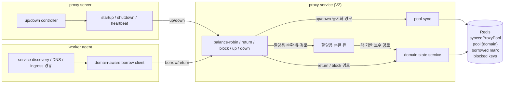
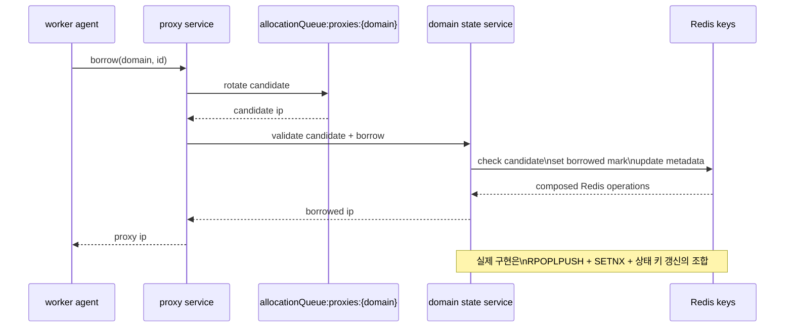
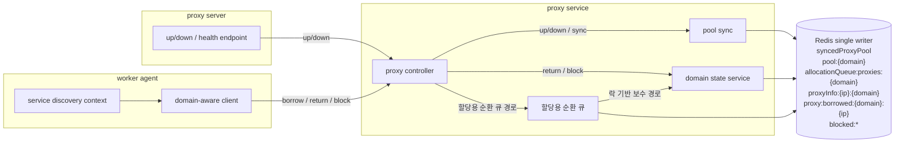

# V2는 무엇을 바꿨는가: 도메인별 기준 풀과 상태 분리

> 이 글은 당시의 구현과 운영 경험을 바탕으로 기억을
> 더듬어 정리한 회고입니다.
> 외부 공개를 위해 실제 서비스명과 내부 식별 정보는
> 일반화했습니다

## 이 글의 범위

1편은 왜 V2가 필요해졌는지, 즉 V1의 순차적 선택(first-fit)과 도메인 비인식 프록시 풀이 왜 운영 요구를 감당하기 어려웠는지를 다뤘습니다.
이 글은 그 다음 질문을 다룹니다.

- V2는 구조적으로 무엇을 바꿨는가
- 왜 `pool:{domain}` 과 `allocationQueue:proxies:{domain}` 가 함께 필요했는가
- 왜 이 구조가 선택 정책뿐 아니라 정합성까지 함께 개선했는가

즉 이 글은 V2의 구조 변화와 그 부수 효과를 설명하는 2편입니다.

## 핵심 전환: 전체 프록시 집합이 아니라 도메인별 기준 풀(domain pool)

V2에서 가장 중요한 변화는 프록시를 하나의 전역 집합으로만 보지 않고, 도메인별 사용 가능한 후보 집합으로 나눠 본 점입니다.
핵심 자료구조는 이런 형태였습니다.

- `syncedProxyPool`
- `pool:{domain}`
- `allocationQueue:proxies:{domain}` (할당용 순환 큐)
- `proxy:borrowed:{domain}:{ip}`
- `proxyInfo:{ip}:{domain}`

이 구조로 바뀌면 프록시를 바라보는 기준 자체가 달라집니다.

- 전체 풀에서 첫 번째 가용 프록시를 찾는 대신
- 특정 도메인에 대해 쓸 수 있는 후보 집합을 먼저 정하고
- 그 집합 안에서 선택 정책을 적용할 수 있게 됩니다.

그림으로 보면 V2의 기본 구조는 아래처럼 정리할 수 있습니다.

즉 V2의 핵심은 라운드 로빈이라는 알고리즘 하나가 아니라, `도메인별로 분리된 자료구조 위에서 정책을 적용할 수 있게 만든 것`입니다.

## 왜 도메인별 기준 풀이 필요했나

### 1. 도메인별 격리

특정 도메인에서 차단되거나 품질이 나쁜 프록시를 해당 도메인 풀에서만 제외할 수 있어야 했습니다.
즉 "전체 프록시가 나쁘다"가 아니라 "이 도메인에서만 나쁘다"를 표현할 수 있어야 했습니다.

이 차이는 운영에서 매우 중요합니다.
`domain-a`에서 차단된 프록시는 `pool:domain-a`에서만 제외하고, 다른 도메인 풀에서는 계속 사용할 수 있어야 했습니다.

V1에서는 이 차이를 풀 수준에서 모델링하기 어려웠습니다.
V2는 아예 자료구조를 도메인 기준으로 나눠서 이 문제를 정면으로 해결하려고 했습니다.

### 2. 선택 정책과 상태 모델의 분리

V1에서는 borrow/return 상태와 선택 정책이 강하게 섞여 있었습니다.
V2에서는 적어도 개념적으로 이 둘을 분리할 수 있게 됩니다.

- 상태: borrowed mark, lease, block, request 결과
- 선택 정책: 순환 선택, 할당용 순환 큐, 락 기반 보수 경로

이 분리가 중요합니다.
선택 정책을 바꾸기 위해 소유권 모델 전체를 흔들 필요가 줄어들고, 반대로 정합성 장치를 강화하기 위해 선택 정책을 다시 짜지 않아도 됩니다.

## 왜 순환 선택이 필요했나

순차적 선택은 가장 단순한 정책이지만, 순회 기반 구조에서는 앞쪽 편중이 쉽게 발생합니다.
V2는 이 문제를 줄이기 위해 `RPOPLPUSH` 같은 순환 선택 성격을 활용하는 구조로 갔습니다.

질문은 단순합니다.

- 매번 앞쪽 후보를 먼저 볼 것인가
- 아니면 후보 집합을 순환시키며 편중을 줄일 것인가

이 선택의 목적은 명확합니다.

- 후보를 순환시켜 편중을 줄이기
- 특정 프록시만 과도하게 소모되지 않게 하기
- pool 전체를 더 고르게 사용하기

물론 이 구조가 완전한 공정성을 보장하는 것은 아닙니다.
차단 상태, borrowed 상태, 순환 큐 미스, 락 기반 보수 경로, 재시도 패턴이 섞이면 실제 분배는 더 복잡해집니다.
그럼에도 순차적 선택보다 운영적으로 더 예측 가능한 출발점을 만들었다는 점이 중요합니다.

## 왜 도메인별 기준 풀과 할당용 순환 큐를 분리했나

여기서 `allocationQueue:proxies:{domain}`를 전통적인 의미의 일반 캐시로 보면 오해가 생깁니다.
`pool:{domain}`도 Redis이고, `allocationQueue:proxies:{domain}`도 Redis입니다.
핵심 차이는 저장소 계층이 아니라 역할입니다.

실제 구조는 이렇게 보는 편이 더 정확합니다.

- `pool:{domain}`: sync가 관리하는 도메인별 기준 풀
- `allocationQueue:proxies:{domain}`: 기준 풀에서 만들어진 할당용 순환 큐
- 락 기반 보수 경로: 순환 큐가 정상적으로 후보를 주지 못할 때 기준 풀을 다시 확인하는 경로

즉 이 구조는 전형적인 캐시 계층이라기보다, 같은 Redis 안에서 `동기화 기준 리스트`와 `할당용 회전 리스트`를 분리한 구조에 가깝습니다.
도메인별 기준 풀을 두는 이유가 모델링이라면, 할당용 순환 큐와 락 기반 보수 경로를 둔 이유는 그 모델을 운영 가능한 처리량과 복원력 위에서 쓰기 위해서였습니다.

## 이 구조가 부수적으로 정합성도 개선한 이유

여기서 중요한 점은, V2가 선택 정책만 바꾼 것이 아니라 `상태를 분리된 키로 더 명시적으로 관리`하게 됐다는 점입니다.

예를 들면 이런 장치들입니다.

- `proxy:borrowed:{domain}:{ip}`
- 요청 식별자(`id`) 기반 결과 재사용
- lease TTL

이런 구조가 들어가면 borrow/return 경로에서 다음 질문을 더 명확하게 다룰 수 있습니다.

- 지금 누가 이 프록시를 점유하고 있는가
- 같은 요청이 다시 오면 기존 결과를 재사용할 수 있는가
- 응답 실패가 나도 상태가 영구히 고착되지 않는가

즉 V2의 구조 개편은 선택 정책만 바꾼 것이 아니라, `정합성을 더 나은 자료구조 위에서 다룰 수 있게 만든 개편`이기도 했습니다.

여기서 중요한 것은 `어떤 연산을 원자적으로 보장해야 하느냐`였습니다.
특히 borrow 경로는 단순 조회가 아니라,

- 후보 프록시를 찾고
- 그 후보가 아직 대여 가능한지 확인하고
- borrowed 상태를 기록하고
- 관련 메타데이터를 함께 갱신해야 하는

다중 키 write-path에 가깝습니다.

이 과정을 애플리케이션 코드에서 여러 번 왕복하며 처리하면, 한 요청이 후보를 읽은 직후 다른 요청이 먼저 같은 후보를 점유해 정합성이 깨질 수 있습니다.

실제 구현은 이 전체를 하나의 거대한 스크립트로 묶기보다, 아래와 같은 Redis primitives 조합에 더 가까웠습니다.

- 후보 회전: `RPOPLPUSH` 같은 단일 원자 명령
- 중복 대여 방지: `SET NX EX` 형태의 borrowed lease key
- 상태 기록: 분리된 Redis key에 대한 개별 갱신
- 일부 안전한 락 해제: compare-and-delete

다만 이런 조각들이 각각 원자적으로 실행될 수 있다는 것과, borrow/return 전체 write-path가 하나의 원자적 경계로 묶여 있다는 것은 다른 이야기였습니다.

즉 핵심은 `도메인별 상태를 분리하고 Redis 원자 연산을 조합해 운영 가능한 구조를 만든 것`이었습니다.

Borrow V2의 핵심 흐름을 단순화하면 아래와 같습니다.

외부 글 기준에서 이 지점의 핵심 메시지는 하나입니다.
V2는 Lua를 중심으로 재설계된 시스템이라기보다, 도메인별 상태를 분리하고 Redis 원자 연산을 조합해 shared resource를 더 예측 가능하게 다루도록 바꾼 구조였습니다.

## TTL 기반 자가 치유

V2에서 TTL은 사소한 부가 기능이 아니라 운영 안전장치입니다.

분산 시스템에서는 "쓰기 성공, 응답 실패"가 완전히 사라지지 않습니다.
요청 식별자(`id`) 기반 결과 재사용은 같은 요청의 재시도를 더 일관되게 만들고, TTL은 설령 orphan 성격의 상태가 남더라도 영구 고착을 줄이는 역할을 합니다.

즉 TTL은 버그를 숨기는 장치가 아니라, `완전한 실패 없음`을 전제하지 않는 운영 구조의 일부입니다.
정확히 말하면 orphan을 제거한 것이 아니라, orphan의 수명을 제한하고 자가 치유 구간을 만든 것입니다.

## 상태 변경 주체가 둘이면 구조는 다시 흔들립니다

도메인 풀과 할당 구조를 도입했다고 해서 바로 안정적인 시스템이 되는 것은 아닙니다.
더 중요한 것은 `누가 상태를 쓰는가`입니다.

상태 변경 주체가 둘 이상이면 같은 자원을 서로 다른 시점에 다른 기준으로 해석하게 됩니다.
그 경우 라운드 로빈이나 도메인 풀 같은 알고리즘을 도입해도 정합성 문제는 다시 드러납니다.

그래서 2편의 결론은 단순히 "라운드 로빈이 더 낫다"가 아닙니다.
정확한 결론은 이겁니다.

- 순차적 선택의 한계를 넘으려면 도메인별 기준 풀이 필요했고
- 도메인별 기준 풀을 운영 가능한 구조로 만들려면 할당용 순환 큐와 락 기반 보수 경로가 필요했고
- 그 상태를 안정적으로 유지하려면 핵심 write-path를 원자적으로 처리하고, 상태 변경 주체를 한쪽으로 고정해야 했습니다.

최종적으로 만들고 싶었던 구조를 단순화하면 아래 그림에 가깝습니다.

이 그림에서 가장 중요한 점은 proxy 상태를 바꾸는 경로가 `proxy service` 하나로 수렴한다는 것입니다.
즉 single-writer를 통해 `syncedProxyPool`, `pool:{domain}`, `allocationQueue:proxies:{domain}` 같은 Redis keyspace의 소유권을 한쪽으로 고정하는 것이 최종 목표였습니다.

## 정리

1편이 `왜 V2가 필요했는가`에 대한 이야기였다면, 2편은 `V2가 무엇을 바꿨는가`에 대한 이야기입니다.

V2의 핵심은 도메인별 기준 풀, 순환 선택, 할당용 순환 큐, 락 기반 보수 경로, 그리고 분리된 상태 키입니다.
그리고 이 구조 덕분에 선택 정책만 좋아진 것이 아니라, 요청 식별자(`id`), TTL, 원자적 write-path 같은 정합성 장치도 더 자연스럽게 들어갈 수 있었습니다.

즉 V2는 단순한 알고리즘 교체가 아니라, 프록시를 운영 가능한 공유 자원으로 다시 모델링한 구조 변경이었습니다.

다만 지금 다시 정리한다면, 핵심 borrow/return/block write-path는 Lua 같은 서버 측 원자 연산으로 더 일관되게 묶는 편이 좋겠다고 봅니다.
당시 구현은 실용적인 Redis 조합으로도 충분히 동작했지만, 후보 선택 이후의 검증과 상태 변경 경계가 여러 단계로 흩어져 있어 원자성의 경계가 다소 분산되어 있었습니다.
