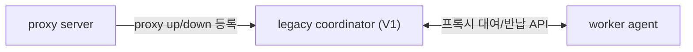
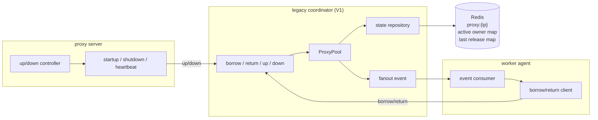
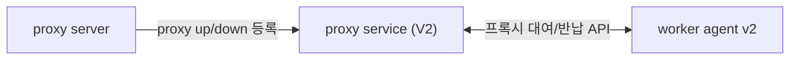
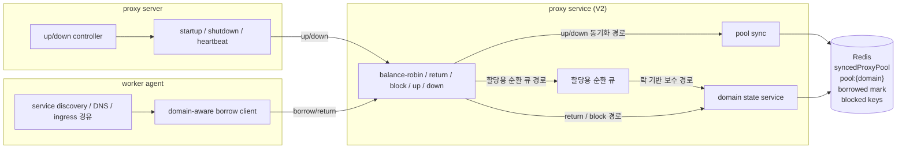
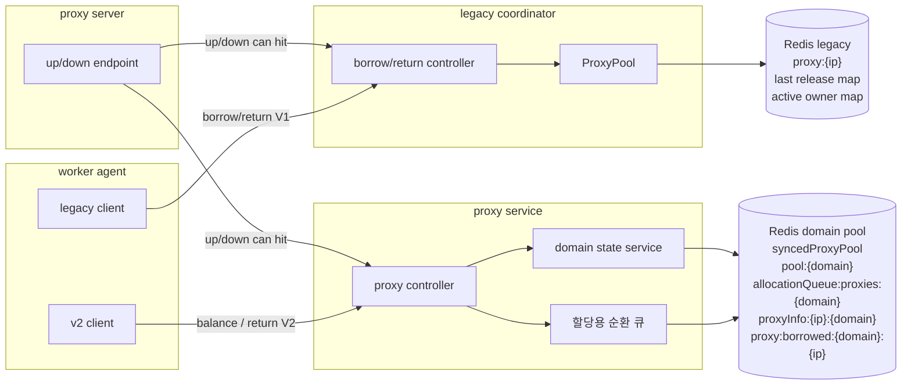
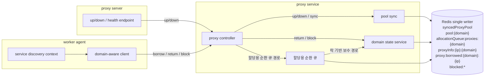
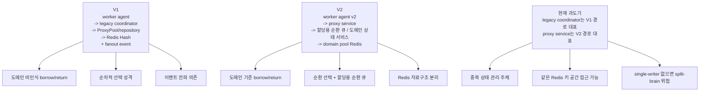

# Proxy Borrow/Return Architecture

## 목적

이 문서는 프록시 대여/반납 구조를 V1과 V2 기준으로 비교하기 위한 기준 문서입니다.
블로그 본문보다 더 구조 중심으로 서술하며, 다음 질문에 답하는 데 초점을 둡니다.

- V1은 어떤 모델 위에서 동작했는가
- V2는 어떤 자료구조와 경로를 새로 도입했는가
- 과도기 구조에서 왜 single-writer가 중요해졌는가

주의할 점은 하나입니다.

- `proxy server`는 실제 대여/반납 호출 주체가 아니라 프록시 서버의 `up/down` 등록 주체입니다.
- 실제 `borrow/return` 호출 주체는 `worker agent`입니다.

즉 사용자 관점에서는 `proxy server -> coordinator/service`처럼 보일 수 있지만, 실제 borrow/return 호출은 `worker agent -> coordinator/service` 경로에서 일어납니다.

## V1

### 요청 관점

### 구조 관점

### 핵심 특성

- 대여/반납은 `worker agent`가 `legacy coordinator`를 직접 호출하는 구조입니다.
- 프록시 서버 생명주기 등록은 `proxy server`가 담당합니다.
- 상태 저장은 `Redis Hash(proxy:{ip})` 중심입니다.
- 프록시 다운 또는 강제 반납 시 fanout 이벤트로 각 에이전트에 상태를 전파합니다.
- 선택 모델은 사실상 `도메인 비인식 순차적 선택(first-fit)`에 가깝습니다.

## V2

### 요청 관점

### 구조 관점

### 핵심 특성

- 대여/반납은 `worker agent v2`가 `proxy service`를 직접 호출합니다.
- 서비스 URL 결정은 service discovery / DNS / ingress 경유 방식으로 이뤄집니다.
- 프록시 선택은 `도메인별 기준 풀 + 순환 선택 + 할당용 순환 큐 + 락 기반 보수 경로` 구조를 따릅니다.
- 상태는 borrowed/block/domain pool 키로 분리 관리됩니다.
- `proxy server`는 여전히 프록시 서버의 `up/down` 등록 역할을 담당합니다.

## 현재 과도기 구조

아래는 이상적인 구조가 아니라, 실제 전환기에서 관찰되는 단순화된 그림입니다.

- `legacy coordinator`는 V1 대여/반납 경로를 대표합니다.
- `proxy service`는 V2 도메인별 기준 풀 / 할당용 순환 큐 경로를 대표합니다.
- 두 서비스가 같은 Redis를 바라보면 `syncedProxyPool`, `pool:{domain}`, `allocationQueue:proxies:{domain}` 같은 키 공간을 동시에 건드릴 수 있습니다.

### 현재 구조의 의미

- `legacy coordinator`는 V1 대여/반납 경로를 대표합니다.
- `proxy service`는 V2 도메인별 기준 풀/할당용 순환 큐 경로를 대표합니다.
- 두 서비스가 동시에 활성화되면 V1 경로와 V2 경로가 병렬로 남는 과도기 구조가 됩니다.
- 이 상태에서는 누가 authoritative writer인지 흐려질 수 있고, single-writer가 없으면 split-brain 위험이 생깁니다.

## 최종 목표 아키텍처

아래는 V2의 목표 상태입니다.

- `proxy service`만 proxy domain의 single writer입니다.
- `legacy coordinator`는 proxy domain에서 완전히 빠집니다.
- `proxy server`는 `proxy service`로만 `up/down/health`를 보냅니다.
- `worker agent`는 `proxy service`로만 `borrow/return/block`을 호출합니다.
- `syncedProxyPool`, `pool:{domain}`, `allocationQueue:proxies:{domain}`를 포함한 Redis keyspace write는 `proxy service`만 수행합니다.

### 최종 구조의 의미

- `legacy coordinator`는 proxy 상태 저장/대여/반납 경로에서 제거됩니다.
- `proxy service`가 `pool sync`와 도메인 기반 Redis 자료구조를 함께 소유합니다.
- `syncedProxyPool`, `pool:{domain}`, `allocationQueue:proxies:{domain}`는 오직 한쪽에서만 생성하고 갱신합니다.
- 결과적으로 proxy 상태에 대한 authoritative writer는 `proxy service` 하나만 남습니다.

## 비교 요약

## 메모

이 문서는 외부 공유용으로 정리한 구조 문서입니다.
구체적인 내부 클래스명과 저장소 경로는 본문에서 제거했고, 블로그 본문과 같은 용어 체계를 유지하는 데 집중했습니다.
